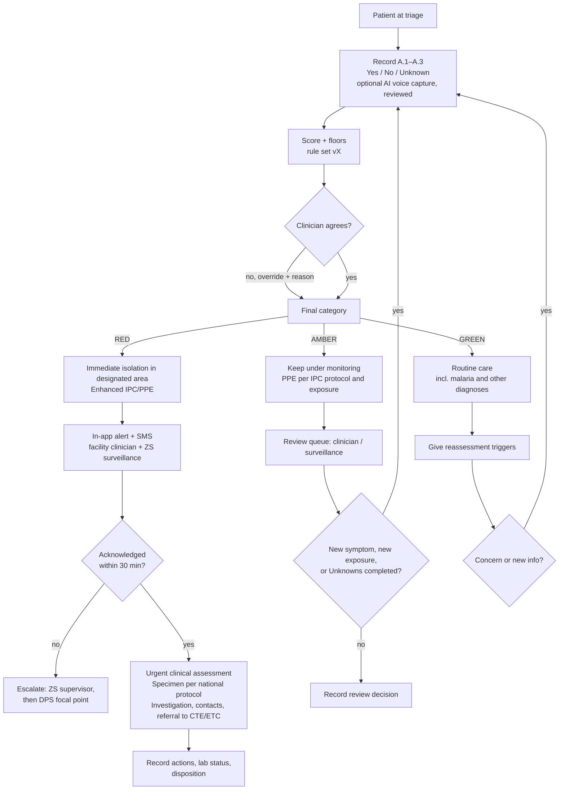
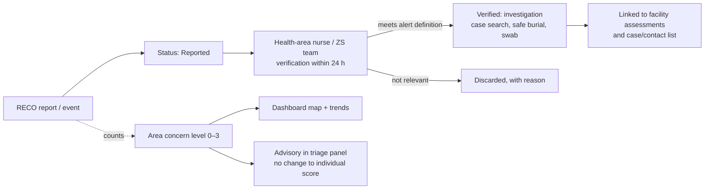

# 4. Alert and decision framework

> **Labels in the app (26 November 2026).** The three categories are shown to users as **High risk**, **Medium risk** and **Low risk** (French: risque élevé, moyen, faible; Kiswahili: hatari kubwa, ya wastani, ndogo), in red, amber and green. The score is called the *risk score*. This document and the data keep the codes RED, AMBER and GREEN, which mean the same three categories. The score is still an ordinal index, not a probability of infection.

All action wording is **provisional and must be aligned with the DRC national protocols** (PNLFHV, national IPC guidance, INRB specimen procedures). The tool recommends; it never prevents a clinician from testing, isolating or calling surveillance.

## 4.1 Decision pathway

## 4.2 Actions by category

### RED – high suspicion (score ≥ 70, or floor F1/F3, or clinician)
| # | Action | System behaviour |
|---|---|---|
| 1 | Immediate placement in the facility's designated screening/isolation/holding area, per the approved IPC arrangements | Shown first; recorded as action `isolation` |
| 2 | Enhanced IPC precautions and PPE per national protocol for anyone in contact | Prompt; action `ipc` |
| 3 | Urgent clinical assessment by the responsible clinician | Alert to clinician |
| 4 | Notify designated surveillance personnel | Alert to the zone surveillance focal point |
| 5 | Specimen collection and laboratory testing per national protocol, by trained staff | Action `specimen`; lab status set to "requested" |
| 6 | Prioritise investigation, referral/transfer and contact listing | Action `referral`; record visible to the zone team |
| 7 | Record acknowledgement and actions | Acknowledgement time and delay stored; shown on the dashboard |

**Notification.** In-app notification (works offline on the same device or facility tablet), plus SMS through the MoH gateway once a network is available. The SMS contains only: alert level, record ID, facility, time and an instruction to open the app.
Example: `ALERTE BDBV ROUGE. Dossier BDB-RWA1-261126-GEVV3, CS Rwampara 1, 26/11/26 09:29. Ouvrir l'application pour details. Repondre OK pour accuser reception.`
**No name, age, symptoms or exposures go in the SMS.**

**Escalation (configurable).** If not acknowledged within 30 minutes, notify the zone surveillance supervisor. If not acknowledged within 2 hours, notify the DPS focal point. Every escalation is logged.

### AMBER – medium suspicion (50–69, or floor F2, or clinician)
- Continued clinical monitoring; no discharge without review.
- PPE level according to the IPC protocol and the assessed exposure.
- Added to the review queue for the responsible clinician or surveillance officer.
- Reassess whenever a new symptom or exposure emerges, and complete Unknown items.
- Record any change in clinical status or category (category history).
- If the community-context panel shows elevated or high concern, the advisory recommends discussing the case with surveillance.

### GREEN – low suspicion (< 50)
- Routine clinical care, including testing for malaria and other causes.
- Reassessment triggers shown to the health worker: new fever, any bleeding, vomiting or diarrhoea, newly discovered contact or funeral exposure, deterioration, or a death in the household.
- The assessment can be updated at any time.
- The screen states explicitly: **a low score does not prevent testing or isolation if the clinician is concerned.**

## 4.3 Safeguards
- **Clinician override** in either direction. Downward overrides need a justification and are flagged on the dashboard for review.
- **Incomplete assessments**: if the potential category is higher than the observed one, a warning lists the unknown items.
- **Out-of-window exposures** are displayed (not silently dropped).
- **Rule-set version** stored with every result.
- **No automated isolation or test orders.** The system records human decisions.

## 4.4 Community signal pathway (Module B)

Immediate reporting by phone remains mandatory for suspected Ebola deaths and clusters (IDSR/CEBS practice). The app records the signal; it does not replace the phone call.

## 4.5 Early-warning signals
A statistical signal (current week > mean + 2 SD of the previous 4 weeks, minimum count 2) is shown as **"Signal statistique (non confirmé)"**. It triggers a review by the zone surveillance team within 48 hours. It never declares an outbreak and never changes individual categories.
