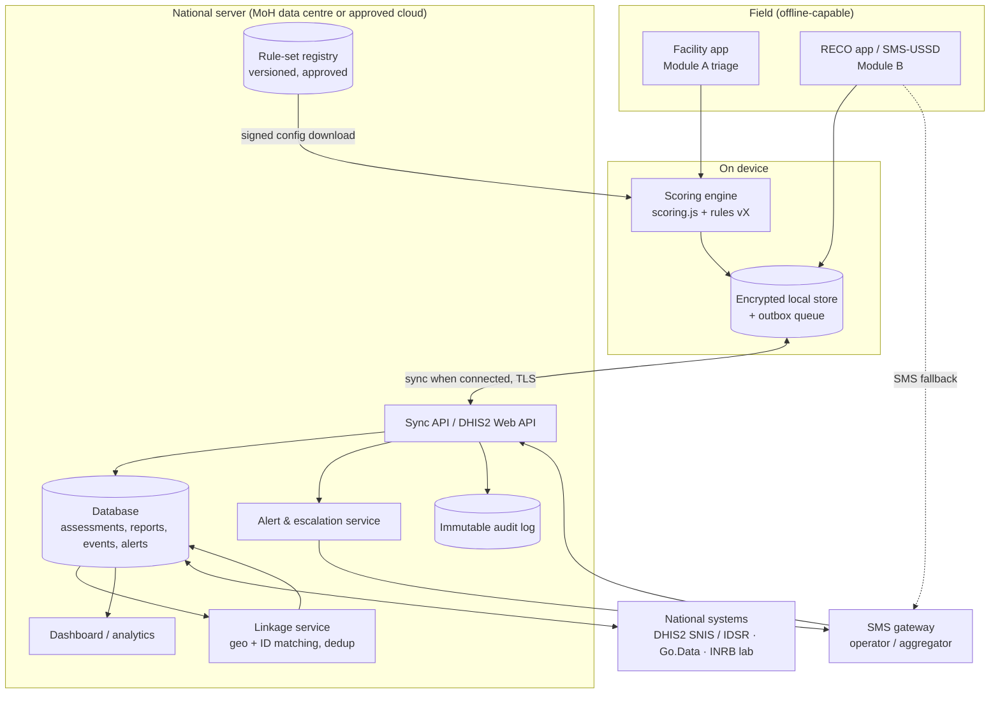
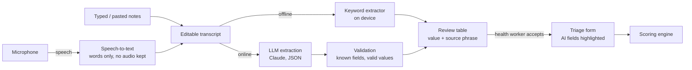

# 5. System architecture

## 5.1 Recommended approach: build on existing national platforms

The DRC already uses **DHIS2** for the national health information system (SNIS), and Ebola responses have used ODK/KoboToolbox-type mobile collection, Go.Data for contacts, and EWARS-type alert systems. ([Keïta et al., 2021](https://consensus.app/papers/details/w:58db0b52-5da0-4afa-9c44-6f1941f243c6/?utm_source=claude_desktop) evaluated an EWARS in Beni that handled 194,768 alerts.) A new stand-alone platform would duplicate infrastructure and training. The recommended production architecture is:

- **Option A (recommended): DHIS2 Tracker + Android Capture app**, with a custom web/Android app for the scoring and result screens, using DHIS2 program rules or a shared JavaScript engine (this repository's `scoring.js`). Strengths: national ownership, offline sync, org-unit hierarchy, role-based access and audit already in place.
- **Option B: a dedicated offline-first PWA/Android app** (like the prototype) backed by its own API and database, exchanging data with DHIS2 and Go.Data. More freedom of UX, more maintenance.

The prototype demonstrates the UX and logic in a platform-neutral way. The choice between A and B is an **MoH/DSNIS decision** (to confirm).

## 5.2 Logical components

## 5.3 Data storage

| Entity | Key | Main links |
|---|---|---|
| `assessment` | `assessment_id` | `org_unit` (village/area/zone/province), `facility_id`, `patient_key` (hashed), `rule_set_version`, `source_case_id` (optional), `lab_specimen_id` |
| `alert` | `alert_id` | `assessment_id`, `facility_id` |
| `reco_report` | `report_id` | `reco_id`, `org_unit` (village) |
| `event` | `event_id` | `report_id`, `org_unit`, `possible_duplicate_of`, `linked_assessment_ids[]` |
| `rule_set` | `rule_set_id + version` | approval record, change log |
| `audit` | sequence | user, role, action, entity, id, time |

Personally identifiable fields (name, phone, address, DOB) are kept in a **separate table** with column-level encryption, and are joined only for roles authorised to see them. Analytics and dashboards run on a **pseudonymised** view.

## 5.4 How the modules communicate (the linkage)

1. **Shared geographic key.** Every assessment and every RECO report carries the official org-unit code down to village/locality where it exists. This is the primary link. Where villages are not in the master list, the health area is the lowest reliable key, and the free-text village is coded later by the zone team.
2. **Facility → community (context).** At assessment time, the device computes the concern level for the patient's village, health area and zone from the community data it holds (synced for the facility's catchment area: 14-day window). The snapshot is stored with the assessment. The server recomputes it on sync.
3. **Community → facility.** For each verified event, the linkage service lists facility assessments from the same village/health area within ±21 days. The verification team reviews them and can attach them (`linked_assessment_ids`).
4. **Facility → surveillance picture.** RED alerts and the category mix by village feed the dashboard and map, so a cluster of RED assessments from one village is visible even before any RECO report.
5. **Identifiers.** Unique IDs with a check character for every record. Optional `source_case_id` on exposures links to the national case/contact list (Go.Data) where available.

### Avoiding duplicate reporting
- **Patients**: `patient_key` match within 30 days triggers a prompt to reopen the existing record (reassessment) instead of creating a new one. Server-side probabilistic matching (name similarity + age ± 2 + village) flags remaining duplicates for review.
- **Community events**: same village + event type + date of occurrence → marked `possible_duplicate_of`. The verifier merges or confirms.
- **Same death reported by RECO and facility (F3)**: matched by village + date ± 2 days + age/sex in the investigation record (not in the RECO form, which has no names).
- **Counts vs events**: dashboards use the report counts for totals and the event list for verification, so the same signal is not counted twice.

## 5.5 Offline and synchronisation
- All forms, scoring, rules and the last 14 days of catchment-area community data are cached on the device.
- Records are written locally first, marked *pending*, and sent by a background queue when a connection is available, with retry/backoff and idempotent server writes using client-generated IDs.
- Conflict rule: assessments are append-only with history. The latest reassessment wins for the current category, and all versions are kept.
- RED alerts are shown in-app immediately on the device. The SMS is sent by the server after sync. Where there is no data network, the device can send the SMS directly (configurable) using the minimal template.
- RECOs without smartphones: a structured **SMS/USSD** report format (e.g. `R <village> <deaths> <unexplained> <suspect> <alerts> <clusters>`), parsed by the gateway into the same report structure.

## 5.6 Security, privacy and access
- TLS 1.2+; encrypted local storage (Android Keystore / DHIS2 Android encryption); device PIN; remote wipe; session timeout.
- Role-based access as in document 01 §1.3, scoped to org units (a facility user sees their facility; a zone officer sees their zone).
- Names hidden from surveillance views by default; "reveal" requires a reason and is logged.
- Decision-makers see aggregates only, with small-number suppression (e.g. counts < 3 shown as "< 3" in public outputs).
- Audit trail of create/view/update/verify/acknowledge/sync/rule changes; server log append-only.
- Legal basis, retention and data-sharing agreements per DRC law and MoH policy (**to confirm**; DRC data-protection provisions to be checked by MoH legal counsel).

## 5.7 AI voice capture component

**Prototype implementation**
| Step | In the claude.ai web page | In the stand-alone prototype (repo) |
|---|---|---|
| Speech-to-text | Platform dictation (Anthropic speech-to-text; the page receives words, never audio) | Browser Web Speech API where available (Chrome sends audio to its vendor's online service) |
| Extraction | Claude, called on the viewer's account | Offline keyword extractor (`voice.js`) |
| Fallback | Typing/pasting; offline extractor | Typing/pasting |

**Options for production (decision for the MoH)**
1. **On-device speech-to-text and extraction** (open speech models that run on mid-range Android, plus the rule-based or a small on-device extractor). This works offline and keeps patient data on the device. Accuracy in French varies and is weaker for Lingala/Swahili. Device requirements are higher.
2. **Server-side processing in an MoH-approved environment**, in-country or under a data-processing agreement. This gives the best accuracy and needs connectivity, so offline facilities fall back to option 1 or typing.
3. **Hybrid**: on-device speech-to-text, then extraction queued for the server when online. The worker still reviews before saving.

**Requirements before any use with real patients**
- MoH approval and a data-protection impact assessment. Voice notes contain names and health data. Data-processing agreements with any external AI or speech provider must cover location, retention and no training on patient data.
- Patient consent wording and a translation, approved by the ethics committee. A documented refusal path: the form works fully without voice.
- **Validation study**: compare AI-extracted fields with manual entry on role-played and then consented real consultations. Measure field-level sensitivity/precision (especially for exposures and bleeding), false "No" answers, time saved, and the rate of answers changed at review. Set acceptance thresholds in advance.
- **Language coverage**: test French and English speech-to-text in field conditions (noise, accents). Lingala, Swahili, Kikongo and Tshiluba speech are expected to need the worker to dictate a French summary.
- Monitoring: `voice.edited_after_ai` rates by field, reviewed monthly. Disable the feature if review is being skipped or edit rates are high.

## 5.8 Configuration and version control
- `config/scoring_rules.json` is the single source for items, points, caps, thresholds, floors, community weights and early-warning parameters.
- Each change is a new version with a change log, author, approver and effective date. Devices download signed rule sets. Each result stores the version used.
- Rule sets are kept in git (this repository) and published by the national team. Translations (`i18n.js`) and master lists (`geo.js` → DHIS2 org units) are separate files.

## 5.9 Interoperability
| System | Exchange |
|---|---|
| DHIS2 / SNIS | Org units, users; aggregate weekly indicators (IDSR); optionally the tracker as the primary store |
| IDSR weekly reporting | Counts of suspected cases and community deaths by zone |
| Go.Data / contact tracing | `source_case_id`; RED patients pushed as suspected cases for investigation |
| INRB / laboratory | `lab_specimen_id`; results returned to `lab_status` (authorised roles only) |
| SMS gateway | Outbound alerts; inbound RECO SMS and acknowledgements ("OK") |
