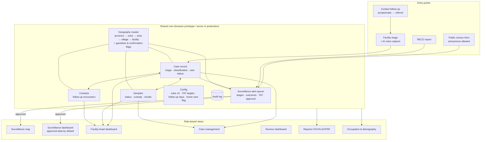
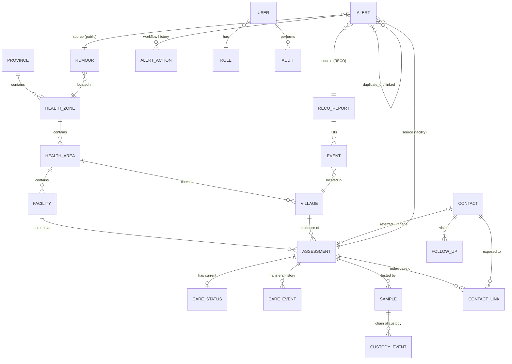

# 9. Version 2: gap analysis and design

This document answers section 17 of the follow-up brief. It reviews the v1 application, then sets out the updated architecture, data schema, role-permission matrix and tab layout used for the v2 implementation. The status of each feature after implementation is in [10_v2_implementation_status.md](10_v2_implementation_status.md).

## 9.1 Gap analysis of the v1 application

v1 baseline (commit `b208e3e`): an offline-first single-page prototype (`prototype/`) with data in browser storage and no server. It has four roles (RECO, health worker, surveillance, decision-maker); Module A triage with provisional scoring, voice capture and RED alerts; Module B RECO reports; event verification with four statuses; a dashboard with a **schematic map using fictitious coordinates**; FR/EN.

| § | Requirement | v1 status | Gap → v2 action |
|---|---|---|---|
| 2 | Interactive surveillance map with layers A–E, filters, click details, time comparison, download | **Partial / non-compliant.** Schematic SVG, village circles at invented x/y, one layer (community concern) | Replace with a geographic map: real DRC outline (Natural Earth), provincial-capital markers and gazetteer-matched zones (GeoNames). No invented coordinates; non-geocoded locations listed separately. Layers A–E, filters, week slider and comparison, marker details, CSV/PDF export |
| 3 | Alert verification workflow (7 stages, 6 outcomes), TAT, configurable targets | **Partial.** RECO events only; 4 statuses; no stages, assignment or TAT; RED alerts have acknowledgement only | New **surveillance alert queue** for all sources (facility, including GREEN; RECO; rumour) with stage timestamps, assignment, findings, outcomes, approval gate for dashboards, four TAT intervals, overdue flags and admin-set targets |
| 4 | Contact tracing and follow-up | **Missing** | New Contacts module: registration, multiple index cases, 10 statuses, follow-up encounters, follow-up dashboard, configurable 21-day period, referral to triage |
| 5 | Laboratory module, chain of custody | **Minimal.** One lab-status dropdown per assessment | New Laboratory tab: samples linked to cases, 11 statuses, custody log, on-site/external testing, results released by lab role only, confirmation only from a released positive result |
| 6 | Patient and case-management dashboard | **Missing** (only lab status and AMBER review) | Care status per case (9 states), responsible clinician, transfers, lab-derived counts; home-based care disabled unless the admin enables it under national protocol |
| 7 | Public rumour reporting and rumour dashboard | **Missing** (RECO only) | Public reporting form (anonymous allowed, no login), verification through the queue, linking, duplicates, escalation, rumour dashboard |
| 8 | Facility-head dashboard | **Missing** | Facility dashboard with throughput, alert, lab, contact and care indicators, timeliness and bottleneck list; no names |
| 9 | Standard age groups | **Missing** (exact age only) | Shared `ageGroup()` (0–9 … 70+) used in all aggregates; exact age kept only in the record |
| 10 | French and Congolese Kiswahili | **Partial.** FR/EN | Kiswahili added as a third language. French becomes the default. Frontline workflows fully translated; remaining screens fall back to French and are listed by the coverage check |
| 11 | Supplied geography; configurable hierarchy | **Missing** (demo geography) | Supplied list 1 loaded as **provinces** and list 2 as **health zones**. Zone→province links are proposed, flagged "to confirm" and editable by the system administrator. Health areas and villages are configurable; demo placeholders are marked |
| 12 | Standard 23-symptom list; scoring review | **Partial** (15 symptoms, different list) | Replaced with the 23 supplied symptoms. DT, DRO and ICT kept unexpanded and unscored. Scoring v0.2 adds correlation groups so correlated symptoms don't add up freely |
| 13 | Reports: 10 types × CSV/Excel/PDF, filters, access control | **Missing** | Reports module with the 10 report types, the requested filters and three formats (SheetJS, jsPDF). Identifiers are included only with permission and a logged reason |
| 14 | Occupational and demographic analysis | **Missing** (occupation captured for patients only) | Occupation and age group added to community death events; analysis tab (cases and deaths by occupation, age group × sex, zone × occupation, weekly trend) with a no-causation notice |
| 15 | 9 roles, least privilege, audit | **Partial** (4 roles) | Central permission matrix (§9.4) drives tabs and actions; audit for all important actions |
| 16 | Multi-entry workflow | **Partial** | Entry points: facility triage, RECO report, rumour, contact referral, lab sample; each links to the queue and the case record |

**Hard constraint carried into every phase:** the prototype has no server or database. All modules are fully functional in the browser with synthetic data. Multi-user operation, real authentication, server-side audit, SMS and attachment storage need the production back end in [05_system_architecture.md](05_system_architecture.md).

## 9.2 Updated architecture

Implementation layout (no build step; plain scripts loaded in order):

| File | Responsibility |
|---|---|
| `geodata.js` | Generated by `tools/build_geodata.js`: DRC outline (Natural Earth 1:50m via world-atlas), provincial capitals and zone matches (GeoNames via cities.json), with source and status for each point |
| `geo.js` | Supplied provinces and health zones, proposed zone→province links with confirmation status, demo health areas, villages and facilities (marked demo, no coordinates) |
| `app.js` | Shell, shared helpers, permission matrix, triage, RECO, scoring UI, v1 dashboard |
| `modules/*.js` | `workflow` (queue, TAT), `map`, `contacts`, `lab`, `casemgmt`, `rumour`, `facility`, `reports`, `analysis`, `admin`, `seed2` (synthetic data for v2 modules) |
| `i18n-sw.js` | Congolese Kiswahili strings (keyed by the English source string) |
| `vendor/` | SheetJS 0.18.5 and jsPDF 2.5.1 + AutoTable 3.8.2 for offline export |

## 9.3 Data schema

Key fields (browser store `db.*`; identical field names in the production schema):

| Entity (`db` key) | Key fields |
|---|---|
| `assessments` | `id`, `geo{province,zone,area,village,facility}`, `person{…, age, age_group, sex, occ}`, `clinical`, `exposures`, `result` (score, category, rule_set), `classification{status: suspected/probable/confirmed/lab_negative/not_a_case, by, at}`, `care{status, location, responsible, history[]}`, `voice`, `contact_id` |
| `queue` (alerts) | `id`, `source`, `source_ref`, `type`, `submitted_at`, `reporter{name, phone, anonymous}`, `geo`, `description`, `info_source`, `stages{acknowledged, assigned, started, completed, approved}` (time + user), `assigned_to`, `outcome`, `findings`, `duplicate_of`, `linked[]`, `urgent`, `history[]` |
| `reports` / `events` | as v1, plus event `deaths`, `age_group`, `sex`, `occupation`, `case_class` (burials), `alert_id` |
| `rumours` | `id`, `type`, `geo`, `place_text`, `date_occurred`, `submitted_at`, `description`, `n_people`, `n_deaths`, `phone`, `relationship`, `anonymous`, `attachment{name,type,size}`, `alert_id` |
| `contacts` | `id`, `first`, `last`, `age_group`, `sex`, `phone`, `address`, `geo`, `index_cases[]`, `exposure{nature, last_date}`, `identified_at`, `officer`, `status`, `status_history[]`, `followups[]{at, symptoms[], temp, exposure, location, officer, action, next_at, outcome}`, `referred_assessment` |
| `samples` | `id`, `case_id`, `type`, `collected_at`, `collection_place`, `collector`, `testing_site{kind: onsite/external, name}`, `received_at`, `method`, `status`, `result`, `released_at`, `released_by`, `repeat`, `comments`, `custody[]{at, action, from, to, by}` |
| `config` | `tat_targets_min{ack, start, complete, approve}`, `followup_days`, `home_care_permitted`, `geo_overrides{zone_province, confirmed, added_areas, added_villages, added_facilities}` |
| `audit` | `at`, `user`, `role`, `action`, `entity`, `id`, `detail` |

## 9.4 Role and permission matrix

✔ = full · R = read · A = aggregated only (no names or identifiers) · own = own facility or own reports · – = none

| Function | Public | RECO | Health worker | Clinician | Surv. officer | Lab | Facility head | HZ surv. officer | Prov./nat. admin | Sys admin |
|---|---|---|---|---|---|---|---|---|---|---|
| Rumour report | ✔ | ✔ | ✔ | ✔ | ✔ | – | – | ✔ | – | – |
| RECO report | – | ✔ | – | – | – | – | – | – | – | – |
| Triage (+voice) | – | – | ✔ | ✔ | – | – | – | – | – | – |
| Assessments list | – | – | own | own | R (pseudonymised) | R (IDs) | A | R (pseudonymised) | – | – |
| Clinical RED alerts | – | – | own | own | R | – | R | R | – | – |
| Verification queue | – | own status | – | – | ✔ | – | R (own facility) | ✔ | – | – |
| Contacts | – | – | – | R | ✔ | – | A | ✔ | – | – |
| Laboratory | – | – | R | R | R | ✔ (results) | A | R | – | – |
| Case management | – | – | R | ✔ | R | – | A | R | – | – |
| Surveillance map | – | – | – | – | ✔ | – | – | ✔ | ✔ (A) | – |
| Surveillance dashboard | – | – | own | own | ✔ | – | – | ✔ | ✔ (A) | – |
| Rumour dashboard | – | – | – | – | ✔ | – | – | ✔ | A | – |
| Facility dashboard | – | – | – | – | – | – | own | ✔ (any) | A | – |
| Occupation & demography | – | – | – | – | ✔ | – | – | ✔ | A | – |
| Reports, aggregate | – | – | – | – | ✔ | lab only | facility only | ✔ | ✔ | – |
| Reports, with identifiers | – | – | – | – | ✔ (reason logged) | – | – | ✔ (reason logged) | – | – |
| Scoring rules | – | – | – | R | R | – | – | R | R | ✔ |
| Configuration (geography, TAT, home care) | – | – | – | – | – | – | – | – | – | ✔ |
| Audit log | – | – | – | – | – | – | – | ✔ | – | ✔ |

## 9.5 Tab layout per role

| Role | Tabs |
|---|---|
| Public reporter | Report an event (rumour form) |
| RECO | Home · RECO report · Rumour · My reports |
| Health worker | Home · Triage · Assessments · Alerts · Laboratory (read) · Dashboard |
| Clinician | Home · Triage · Assessments · Case management · Alerts · Laboratory (read) |
| Surveillance officer | Home · Verification · Contacts · Map · Dashboard · Rumours · Analysis · Reports · Assessments (pseudonymised) · Alerts · Scoring rules (read-only) |
| Laboratory | Home · Laboratory · Reports |
| Facility head | Home · Facility dashboard · Reports |
| HZ surveillance officer | Home · Verification · Contacts · Map · Dashboard · Facility dashboard · Rumours · Analysis · Reports · Audit |
| Prov./national admin | Home · Map · Dashboard · Rumours · Analysis · Reports |
| System administrator | Home · Configuration · Scoring rules · Audit |
