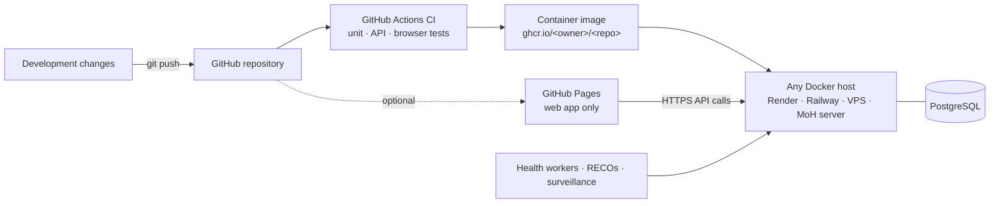

# 11. Backend, hosting and GitHub workflow

## 11.1 What runs where

GitHub holds the code, runs the tests and builds the container image. It **cannot run the server or the database**: GitHub Pages serves static files only. The backend therefore runs as a Docker container on any host (a cloud service for the pilot, a Ministry of Health server later), and GitHub deploys to it.



The API container also serves the web app, so **one deployment is enough**. GitHub Pages is only needed if you want the app on a `github.io` address.

## 11.2 Data rule for this version: synthetic data only

- The server runs only in `DATA_MODE=synthetic`. It refuses to start in any other mode, labels every response (`X-BDBV-Data-Mode: synthetic`), stores `synthetic: true` on every record, and the app shows a "PILOT SERVER - synthetic data only" banner.
- **Do not enter real patient, contact or reporter data.** Real data need, at minimum: MoH approval and hosting approved by the MoH/DSNIS, a data-protection impact assessment, data-sharing and processing agreements, encrypted backups and a restore test, server hardening and a penetration test, real user management (provisioning, password policy, 2FA), and a legal basis for retention (see §11.7).

## 11.3 Components (`backend/`)

| Part | What it does |
|---|---|
| `src/app.js` | REST API `/api/v1`: login, sync, records, identifiers, public rumours, config, audit, history. Security headers (CSP, nosniff, frame-deny, HSTS behind HTTPS), CORS limited to `ALLOWED_ORIGINS`, request size limit, rate limits on login and public reports |
| `src/permissions.js` | Server-side permission matrix: who reads which records (facility, zone, ownership scoping in SQL), who writes what, protected transitions (lab results, confirmation, verification stages, referral fields), and redaction of names and phone numbers by role |
| `src/auth.js` | bcrypt password hashes, signed tokens (12 h), account re-checked on every request (deactivation takes effect at once) |
| `src/shared.js` | Reuses the app's scoring engine and rule set: **the server recomputes every triage score** and ignores the client's value. Also runs the app's synthetic-data generator headless |
| `src/schema.sql` | PostgreSQL: `records` (JSON documents + scope columns + version), `record_history` (every previous version), `audit_log` (**append-only, enforced by database triggers**), `users`, `config` |
| `src/seed.js` | Demo accounts (one per role) and synthetic data |

**Sync model (offline-first).** The app keeps working offline. When connected it sends unsynchronised records and pulls changes since its last sync. Every record carries a version number: if someone else changed a record first, the server refuses the stale copy and the app takes the server's version (reported to the user). Records refused for permission reasons are flagged and not retried.

**Personal data.** Only clinical staff of the facility receive patient names. Surveillance roles receive pseudonymised records and can reveal names only through `/api/v1/identifiers`, with a written reason logged on the server; revealed names are used for the export and not stored on the device. Anonymous public reports keep no phone number.

### Demo accounts

| Username | Role | Scope |
|---|---|---|
| `reco.aru` | RECO | own reports |
| `nurse.aru` | Health worker | CS Aru 1 (demo) |
| `clinician.aru` | Clinician | CS Aru 1 (demo) |
| `surveillance` | Surveillance officer | all, pseudonymised |
| `lab` | Laboratory | samples; cases pseudonymised |
| `head.aru` | Facility head | CS Aru 1, no names |
| `zone.aru` | HZ surveillance officer | health zone Aru |
| `admin.ph` | Prov./national administrator | aggregate views |
| `sysadmin` | System administrator | configuration, audit |

Passwords: the value of `SEED_USER_PASSWORD`, or, if it is empty, a random password per account printed **once** in the server log at first start.

## 11.4 Run it on your computer

Requires Docker Desktop (or Docker Engine with Compose).

```bash
cp .env.example .env
```

Edit `.env`: set `POSTGRES_PASSWORD`, `JWT_SECRET` (32+ characters, e.g. from `openssl rand -base64 48`) and `SEED_USER_PASSWORD`. Then:

```bash
docker compose up -d
```

Open http://localhost:8080. The sign-in screen asks for a username and password: use a demo account from §11.3 with the `SEED_USER_PASSWORD` you set. The public report form is available from the same screen without an account. Stop with:

```bash
docker compose down
```

## 11.5 Host it (choose one)

**A. Render.com (blueprint in the repository, quickest).**
1. Create a Render account and connect GitHub.
2. *New > Blueprint*, then select this repository. `render.yaml` creates the API service and a PostgreSQL database.
3. When asked, set `SEED_USER_PASSWORD`. Leave `ALLOWED_ORIGINS` empty unless you use GitHub Pages.
4. Open the service URL. Each push to `main` redeploys.

The free tier sleeps when idle, and Render's free databases expire after a period; check Render's current terms.

**B. Any server with Docker (VPS, Ministry server, Railway, Fly.io…).**
- Run `docker compose up -d` on the server with a `.env` (as in §11.4), behind HTTPS (e.g. Caddy or nginx with a certificate) and `TRUST_PROXY=true`.
- Or run the image built by CI, `ghcr.io/<owner>/<repo>:latest`, with a managed PostgreSQL: set `DATABASE_URL`, `JWT_SECRET`, `SEED_DEMO`, `SEED_USER_PASSWORD`.

**C. Optional: web app on GitHub Pages.**
1. Settings > Pages > Source: *GitHub Actions*.
2. Settings > Secrets and variables > Actions > *Variables*: set `BDBV_API_URL` to your API address (from A or B).
3. On the API, set `ALLOWED_ORIGINS=https://<owner>.github.io`.
4. Push to `main`, or run the *Publish app to GitHub Pages* workflow by hand.

### Environment variables

| Variable | Required | Meaning |
|---|---|---|
| `DATABASE_URL` | yes | PostgreSQL connection string (add `?sslmode=require` for managed databases that need TLS) |
| `JWT_SECRET` | yes | Token signing secret, 32+ characters. Keep it secret; changing it signs everyone out |
| `DATA_MODE` | no | Must be `synthetic` (the only supported value) |
| `SEED_DEMO` | no | `true`: create demo accounts and synthetic data on first start |
| `SEED_USER_PASSWORD` | no | Password for all demo accounts (otherwise random, printed once) |
| `ALLOWED_ORIGINS` | no | Comma-separated origins allowed to call the API from a browser (e.g. GitHub Pages) |
| `TRUST_PROXY` | no | `true` behind a reverse proxy / platform load balancer |
| `PORT` | no | Default 8080 |
| `TOKEN_TTL` | no | Token lifetime, default `12h` |

## 11.6 GitHub Actions

| Workflow | When | What |
|---|---|---|
| `CI` (`.github/workflows/ci.yml`) | every push and pull request | Unit tests; backend API tests against a PostgreSQL service; browser tests of the offline app; starts the API with synthetic data and runs browser tests against it; builds the Docker image and, on `main`, publishes it to `ghcr.io` |
| `Publish app to GitHub Pages` (`pages.yml`) | push to `main` (app files) or manual | Publishes `prototype/` with `config.js` pointing at `BDBV_API_URL` |

The development branch is `claude/great-shannon-chjevm`. Merging it into `main` (through a pull request) triggers the image publication and Pages deployment.

## 11.7 Tests (run locally in this session)

| Test | Result |
|---|---|
| `backend`: `npm test` against PostgreSQL 16 (16 tests: health/data mode, authentication, scoping, redaction, server rescoring, write permissions, lab-only results, verification rights, version conflicts and history, incremental sync, public rumours and rate limit, identifier reveal with logged reason, configuration rights, append-only audit, input validation, historical data: counts only, import rights, batches locked) | 16/16 pass |
| `tests/e2e_server.test.js` against the Docker Compose stack: app served by API, password sign-in shown and no demo accounts offered; public rumour to server without an account; nurse signs in (role from account, facility scope, names), triage synced and rescored to RED; surveillance without names; rumour acknowledged and synced; identifier export fetched from server with reason audited; Excel/PDF under the CSP; no CSP or JS errors | 7/7 pass |
| Existing suites (scoring, voice, i18n, offline e2e v1 and v2, boundary import) | pass |
| Docker image build (dependencies verified at build time) and `docker compose up` | pass |

The GitHub Actions workflows were written and checked for valid YAML, but have **not yet run on GitHub**: they run at the next push. The Render blueprint has not been deployed from here.

## 11.8 Not done yet (needed before real data or scale)

- User administration screens (create/deactivate accounts, reset passwords), password policy, two-factor authentication. Demo accounts are seeded.
- Server-side SMS alerts and escalation (needs an SMS gateway contract), and attachment storage for rumour photos.
- Backups and restore procedure, monitoring and alerting, log retention policy.
- Field-level merge of concurrent edits. Currently the first writer wins and the second gets the server copy.
- DHIS2 / IDSR / Go.Data / laboratory system interfaces.
- Penetration test, data-protection impact assessment, MoH approval: see §11.2.

## 11.9 Importing official boundaries (shapefile)

The map can draw official province and health-zone boundaries. None are included yet: they have to come from the Ministry of Health (DSNIS) or a source it accepts, such as GRID3. Until a file is imported, markers sit at provincial capitals and GeoNames towns, as described in document 10.

**What to send.** One layer for health zones and, if available, one for provinces. Any of these works:
- an ESRI shapefile, meaning the `.shp` together with its `.shx`, `.dbf` and `.prj` (and `.cpg` if there is one);
- the same files in one `.zip`;
- GeoJSON;
- a GeoPackage (`.gpkg`). Reading it needs Node.js 22.5 or later. One table can hold several levels; choose the rows with `--zone-filter` and `--province-filter`.

Projected files (UTM, for example) are converted to latitude/longitude using the `.prj`. Put the files in `data/boundaries/` on the development branch (GitHub: *Add file → Upload files*), or attach them in the chat, and say where the data come from and which version they are.

**Run the import.**

```bash
cd tools && npm install && cd ..
```

```bash
node tools/import_boundaries.js --zones data/boundaries/zones.zip --provinces data/boundaries/provinces.zip
```

The tool guesses which attribute holds the name (`NOM_ZS`, `ADM2_FR`, `Nom`, …). If it guesses wrong, name it with `--zone-field`, `--province-field` or `--zone-province-field`. `--tolerance` sets how much the outlines are simplified (default 0.005 degrees, about 500 m). Provinces and zones are simplified together so shared borders stay identical, and the result is stored as a compact topology that the app expands when it loads. `--alias "Name in file=Name in list"` accepts a spelling variant on purpose; every alias is listed in the report.

**What it writes.**

| File | Content |
|---|---|
| `prototype/boundaries.js` | Simplified outlines and the centre of each unit, loaded by the map |
| `docs/boundaries_import_report.md` | Which names matched the supplied province and health-zone lists, which did not, and how each zone's province in the file compares with the link proposed in the app |
| `config/zone_province_from_boundaries.json` | The zone → province links found in the file |

Names are matched after removing accents, case and prefixes such as "ZS" or "Zone de santé". A name that does not match is listed in the report and drawn as context with no data. It is never attached to the nearest list entry. The zone → province links in the file are not applied automatically: the system administrator reviews the report and confirms each link under *Configuration → Geographical hierarchy* (system administrator account), which is audited.

**What changes on the map.** Units are drawn with their outlines, units with events in the period are shaded, and each marker moves to the centre of its official boundary. Marker details say "centre of the official boundary" so the source of the position stays visible. Markers are still totals per administrative unit, never the position of a household, grave or facility.

The tool is tested on synthetic squares as a shapefile, GeoJSON, a UTM shapefile and a GeoPackage (`tests/boundaries.test.js`).

### Import done on 26 November 2026

The project supplied `DRC_admin_boundaries_ADM1_ADM2_ADM3.gpkg` (now in `data/boundaries/`), downloaded from the Humanitarian Data Exchange.

**Citation.** OCHA, *Democratic Republic of the Congo - Subnational Administrative Boundaries* (COD-AB), Humanitarian Data Exchange, https://data.humdata.org/dataset/cod-ab-cod. Source credited on HDX: Référentiel Géographique Commun (RGC). Version valid from 11 September 2019. The citation is stored with the boundaries (`--citation`) and shown under the map and the dashboard map. The licence shown on the HDX page should be checked before the file is redistributed outside the project.

 It holds one table with 26 provinces (ADM1), 164 territories (ADM2) and 519 health zones (ADM3), with P-codes and a validity date of 11 September 2019. The command used was:

```bash
node tools/import_boundaries.js --zones data/boundaries/DRC_admin_boundaries_ADM1_ADM2_ADM3.gpkg --zone-filter ADM_LEVEL=ADM3 --zone-field ADM_NAME --zone-province-field ADM1_NAME --provinces data/boundaries/DRC_admin_boundaries_ADM1_ADM2_ADM3.gpkg --province-filter ADM_LEVEL=ADM1 --province-field ADM_NAME --alias "Banjow Moke=Banzow Moke" --citation "OCHA, Democratic Republic of the Congo - Subnational Administrative Boundaries (COD-AB), Humanitarian Data Exchange, https://data.humdata.org/dataset/cod-ab-cod; source credited on HDX: Référentiel Géographique Commun (RGC); version valid from 2019-09-11"
```

Results (full detail in `docs/boundaries_import_report.md`):
- all 26 provinces and all 26 supplied health zones matched. "Banzow Moke" is spelt "Banjow Moke" in the file (Maï-Ndombe, P-code CD330201) and was matched through the alias above. The project confirmed on 26 November 2026 that they are the same zone; the map shows "also written Banjow Moke";
- the other 493 health zones are drawn for context and carry no data in this pilot;
- the file gives a province for every supplied zone. It agrees with the 22 links proposed earlier and fills the 4 that were unassigned: Baka → Haut-Lomami, Banga Lubaka → Kasaï, Bangabola → Sud-Ubangi, Banzow Moke → Mai-Ndombe. The app now uses these links, marked "from the official boundary file (to confirm)";
- `prototype/boundaries.js` is 379 KB.


## 11.10 Historical data on the server

Imported historical data (document 07, *Historical data* tab) are stored as a `history` collection: one record per uploaded batch, holding weekly counts per province or health zone and nothing else. The server checks every batch: only the expected fields are accepted, each row must be a date, place codes and six non-negative whole numbers, so names or other personal fields cannot be stored there. Surveillance officers, health-zone officers and public-health administrators can import and read batches (all zones, since the data are aggregated). Clinical and community roles do not receive them. A batch cannot be edited after upload; it can only be withdrawn, and both actions are kept in the record history and the audit log.

The pilot server still runs with synthetic data only (§11.2). Aggregated counts that have already been published, such as situation-report figures, carry no personal data, but uploading them to the pilot should be agreed with the Ministry of Health first.
