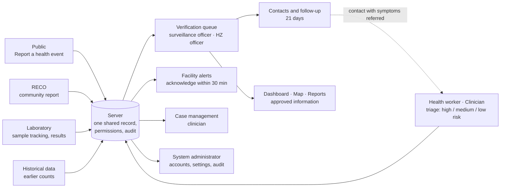

# 12. Information flow and where each role checks

Everyone works in the same system at https://bdbv-api.onrender.com (pilot, synthetic data only). A step done by one person is seen by the next as soon as their device synchronises.

## 12.1 The whole picture

## 12.2 Step by step

**1. A patient at a health facility**

| Step | Who | Tab | Time target |
|---|---|---|---|
| Triage the patient and save (voice capture optional, answers checked) | Health worker / Clinician | Triage | - |
| High risk: alert created for the facility; isolate, infection control, call surveillance, request a sample, then acknowledge and tick the actions | Health worker / Clinician | Alerts | 30 min |
| Medium risk: re-assess and mark as reviewed | Clinician | Assessments | 24 h |
| Every assessment, low risk included, goes to the verification queue: receive, assign, verify, record the outcome, approve | Surveillance officer / HZ officer | Verification | receive 1 h, start 4 h, complete 1 day, approve 12 h |
| Verified and approved information appears on the dashboard and map | Public health administrator, facility head | Dashboard, Map | - |

**2. A sample to the laboratory**

| Step | Who | Tab |
|---|---|---|
| Request a test for the case (or tick "sample requested" on the alert) | Health worker / Clinician | Laboratory, Alerts |
| Assign the lab ID, record sample type, collection date and time, and on-site testing or the referral laboratory | Laboratory personnel | Laboratory |
| Enter the result (the signed-in account is recorded as the tester) | Laboratory personnel | Laboratory |
| Approve and release the result (only the manager can) | Laboratory manager | Laboratory |
| Case classified from the result; clinician sees it | Clinician | Case management, Assessments |
| Confirmed case visible without the name | Surveillance officer, public health administrator | Map, Reports |

**3. Community reports and public alerts**

| Step | Who | Tab |
|---|---|---|
| Send the community report (kept on the phone when offline, sent at the next sync) | RECO | RECO report |
| Report an event with no account, anonymously if wished; deaths make it urgent | Public | Report |
| Verify in the field, record the outcome, flag duplicates | Surveillance officer / HZ officer | Verification, Rumours |
| Follow the status of each report sent | RECO | My reports |

**4. Contacts of a case**

| Step | Who | Tab |
|---|---|---|
| Register the contacts and plan the visits (21 days) | Surveillance officer / HZ officer | Contacts |
| Record each daily visit; refer a contact with symptoms | Surveillance officer / HZ officer | Contacts |
| Referred contact appears at the top of the facility list; triage starts pre-filled and the result is linked back | Health worker / Clinician | Assessments, Triage |

**5. Oversight, accounts and settings**

| Step | Who | Tab |
|---|---|---|
| Approve account requests (role and facility or zone); give temporary passwords | System administrator | Configuration |
| Follow facility activity and delays, without names | Facility head, HZ officer | Facility dashboard |
| Read the situation from approved, aggregated information; compare with earlier waves | Public health administrator | Dashboard, Map, Historical data |
| Review views, changes and exports | System administrator, HZ officer | Audit log |

## 12.3 Where each person should check

| Role (demo account) | Tabs | Check | What to look for |
|---|---|---|---|
| RECO (`reco.aru`) | RECO report, Report, My reports | Weekly, and at once for any death or cluster | Send the report; sync; follow each report's status |
| Health worker (`nurse.aru`) | Triage, Assessments, Alerts, Laboratory, Dashboard | Every patient; alerts and referred contacts at the start of each shift | High-risk alerts to acknowledge; referred contacts; samples to send |
| Clinician (`clinician.aru`) | Triage, Assessments, Case management, Alerts, Laboratory | Several times a day | Medium-risk patients to review; lab results; care status and transfers |
| Surveillance officer (`surveillance`) | Verification, Contacts, Map, Dashboard, Rumours, Analysis, Historical data, Reports, Assessments, Alerts, Scoring rules | Queue continuously; contacts daily | New and overdue alerts; contacts due for a visit; unusual increases on the map |
| HZ surveillance officer (`zone.aru`) | Verification, Contacts, Map, Dashboard, Facility dashboard, Rumours, Analysis, Historical data, Reports, Audit log | Daily, for the zone | The zone's queue and contacts; facilities with delays |
| Laboratory personnel (`lab`) | Laboratory, Reports | When requests and samples arrive; daily | New requests; samples in transit; results to enter |
| Laboratory manager (`labmgr`) | Laboratory, Reports | Several times a day | Results awaiting approval; repeat tests |
| Facility head (`head.aru`) | Facility dashboard, Reports | Daily | Unacknowledged alerts, patients not reviewed, samples not sent |
| Public health administrator (`admin.ph`) | Map, Dashboard, Rumours, Analysis, Historical data, Reports | Daily or weekly | Where high-risk patients and cases are; trends against earlier waves (aggregate only) |
| System administrator (`sysadmin`) | Configuration, Scoring rules, Audit log | Daily | Account requests and forgotten passwords; settings; audit log |

## 12.4 Who sees names

- Health workers and clinicians see the names of their own facility's patients.
- Surveillance sees records without names. A list with names can be exported only with a written reason, which is logged.
- Facility heads and administrators see counts and indicators, not people.
- A RECO sees only its own reports. Public reporters can stay anonymous.

The system supports decisions; it does not diagnose. Only a laboratory result approved by the laboratory manager confirms a BDBV infection, and the clinician's judgement always prevails.
